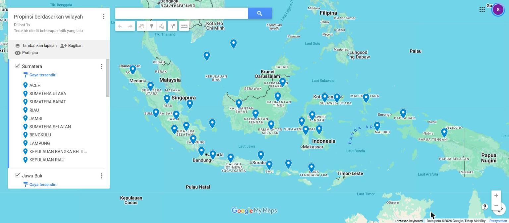
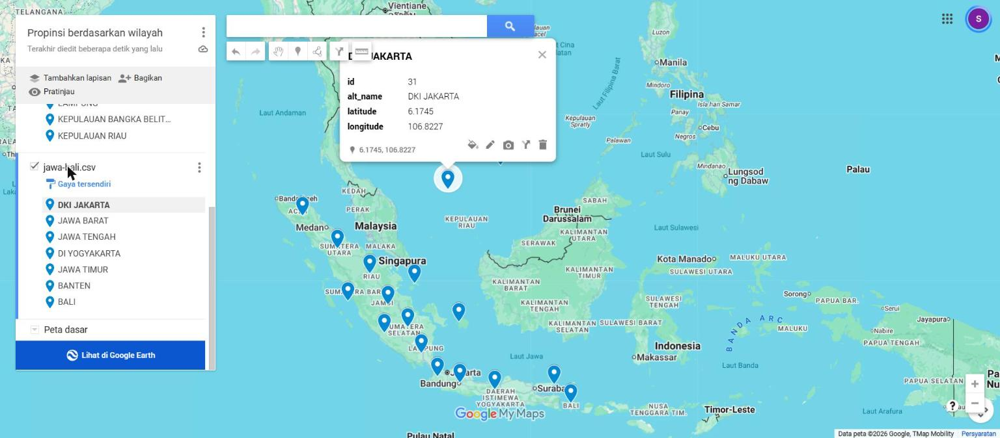
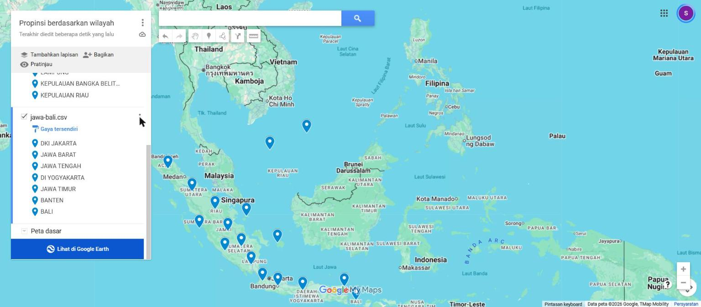
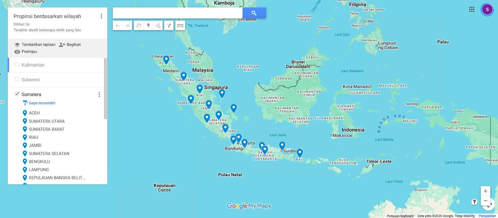
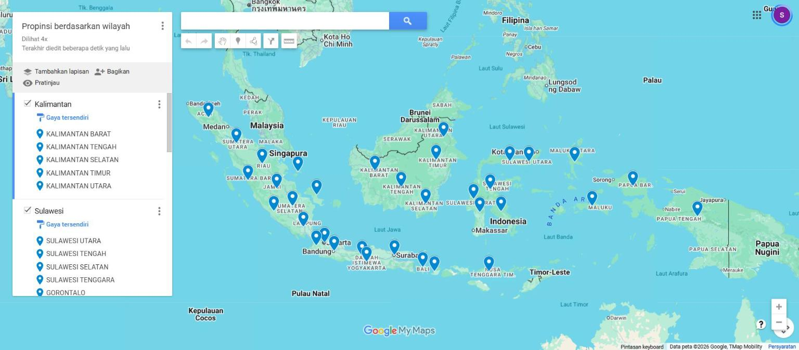
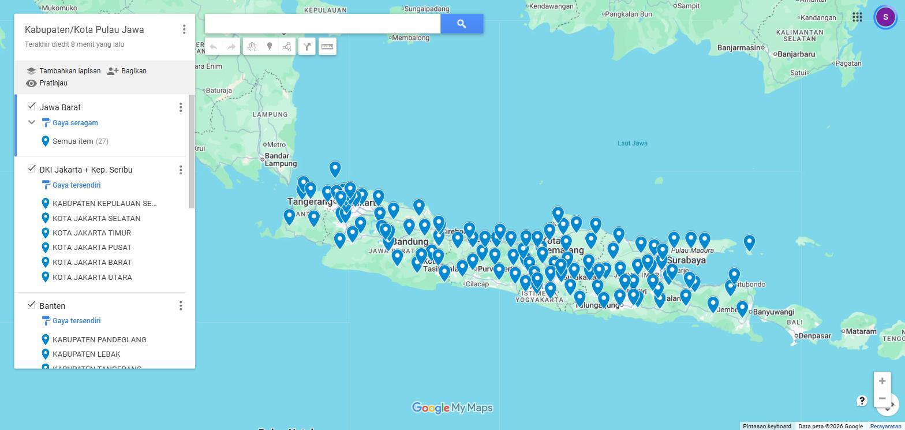
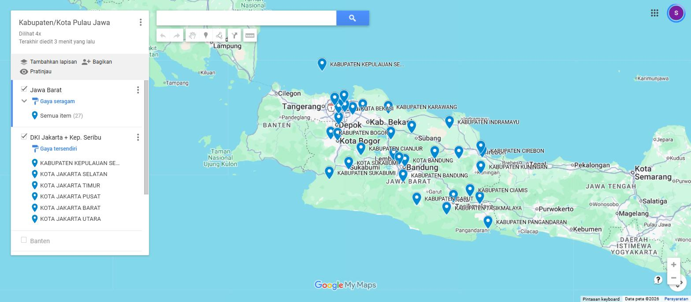
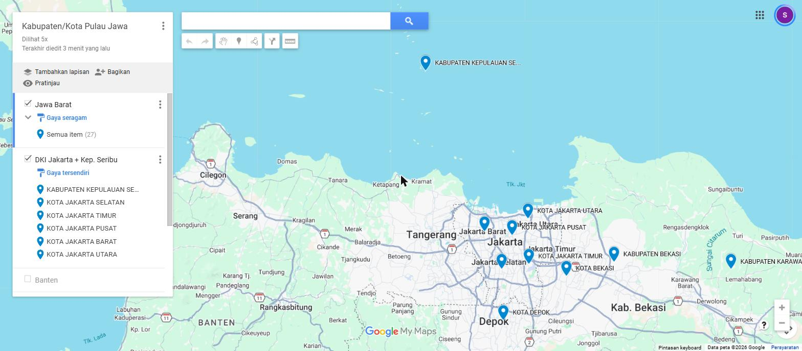

# Praktikum 2 SIG – Aplikasi Google Map 2 (Layer)

**Shodiqun Amin – 0110223202 – Teknik Informatika STT Terpadu Nurul Fikri (2026)**

Mata kuliah Sistem Informasi Geografis · Dosen: Dr. Sirojul Munir, S.Si., M.Kom.

Data titik provinsi dan kabupaten/kota yang dipakai untuk membuat peta berlayer di Google My Maps, sebelum dan sesudah perbaikan koordinat GPS.

## Isi folder

| Folder / file | Isi |
|---|---|
| `provinsi/awal/` | 5 CSV hasil pemecahan data 34 provinsi per pulau besar (sebelum perbaikan) |
| `provinsi/perbaikan/` | 5 CSV per layer setelah koordinat diperbaiki |
| `kabkota_jawa/awal/` | 6 CSV kab/kota Pulau Jawa (119 titik) per provinsi (sebelum perbaikan) |
| `kabkota_jawa/perbaikan/` | 6 CSV per layer setelah koordinat diperbaiki |
| `koreksi_provinsi.csv` | Log 6 koreksi titik provinsi |
| `koreksi_kabkota_jawa.csv` | Log 2 koreksi titik kab/kota |
| `screenshot/` | Screenshot peta Google My Maps (provinsi sebelum/sesudah perbaikan, kab/kota Jawa, layer Jawa Barat + DKI) |

Kolom CSV provinsi: `id, name, alt_name, latitude, longitude`.
Kolom CSV kab/kota: `id, province_id, name, alt_name, latitude, longitude`.

## Pembagian layer

**Peta "Propinsi berdasarkan wilayah"**

| Layer | File | Titik |
|---|---|---|
| Sumatera | sumatera.csv | 10 |
| Jawa-Bali | jawa-bali.csv | 7 |
| Kalimantan | kalimantan.csv | 5 |
| Sulawesi | sulawesi.csv | 6 |
| Indonesia Timur (Nusa Tenggara, Maluku, Papua) | indonesia_timur.csv | 6 |

**Peta "Kabupaten/Kota Pulau Jawa" (Praktikum Mandiri 1)**

| Layer | File | Titik |
|---|---|---|
| Jawa Barat | jawa_barat.csv | 27 |
| DKI Jakarta + Kep. Seribu | dki_jakarta.csv | 6 |
| Banten | banten.csv | 8 |
| Jawa Tengah | jawa_tengah.csv | 35 |
| DI Yogyakarta | di_yogyakarta.csv | 5 |
| Jawa Timur | jawa_timur.csv | 38 |

## Koreksi koordinat

Setiap titik diuji terhadap poligon batas wilayahnya sendiri (uji titik-dalam-poligon dengan Python + Shapely). Titik benar = berada di daratan dan di dalam batas wilayahnya.

**Provinsi (6 dari 34 titik)**

| Provinsi | Awal | Masalah | Perbaikan |
|---|---|---|---|
| DKI Jakarta | 6.1745, 106.8227 | Tanda lintang terbalik, titik di Laut Cina Selatan | -6.1745, 106.8227 |
| DI Yogyakarta | 7.7956, 110.3695 | Tanda lintang terbalik, titik di Laut Cina Selatan | -7.7956, 110.3695 |
| Sumatera Barat | -1.34225, 100.0761 | Di laut (Selat Mentawai), ±32 km dari daratan | -0.93767, 100.36044 (Padang) |
| Kep. Bangka Belitung | -2.75775, 107.58394 | Di laut, ±2,4 km dari pantai barat Belitung | -2.15292, 106.15789 (Pangkalpinang) |
| Nusa Tenggara Barat | -8.12179, 117.63696 | Di laut (Laut Flores), ±3,4 km dari daratan | -8.58148, 116.10975 (Mataram) |
| Jawa Timur | -6.96851, 113.98005 | Di Pulau Madura, ±160 km dari pusat wilayah | -7.24557, 112.73917 (Surabaya) |

**Kabupaten/kota (2 dari 119 titik)**

| Kab/kota | Awal | Masalah | Perbaikan |
|---|---|---|---|
| Kab. Kulon Progo | -7.645, 110.02694 | Titik jatuh di Kab. Purworejo (Jawa Tengah) | -7.85781, 110.15916 (Wates) |
| Kab. Kepulauan Seribu | -5.5985, 106.55271 | Titik di laut, ±0,6 km dari pulau terdekat | -5.74648, 106.61316 (Pulau Pramuka) |

Setelah perbaikan, uji ulang: seluruh 34 titik provinsi dan 119 titik kab/kota berada di dalam wilayahnya.

## Screenshot peta

**Peta "Propinsi berdasarkan wilayah", sebelum perbaikan.** Titik DKI Jakarta dan DI Yogyakarta muncul di Laut Cina Selatan karena tanda lintangnya positif.

**Layer Sumatera dan Jawa-Bali, sebelum dan sesudah perbaikan.**

**Peta provinsi setelah perbaikan (5 layer).**

**Peta "Kabupaten/Kota Pulau Jawa" (6 layer).**

**Layer Jawa Barat dan DKI Jakarta + Kep. Seribu dengan label nama.**

## Cara membuat peta di Google My Maps

1. Buka Google Maps › **Saved** › **Maps** › **Open My Maps** › **Create a New Map**.
   *Cek: muncul peta kosong dengan panel "Untitled map" di kiri.*
2. Klik "Untitled map", ganti nama jadi `Propinsi berdasarkan wilayah`.
3. Di panel kiri klik **Tambahkan lapisan** (Add layer), lalu lewat menu ⋮ layer › **Ganti nama lapisan ini**, ganti jadi `Sumatera`.
4. Klik **Impor** di bawah nama layer › pilih `sumatera.csv`.
   *Cek: muncul pertanyaan "Pilih kolom untuk menempatkan tanda letak Anda".*
5. Centang `latitude` dan `longitude` › **Lanjutkan** › pilih `name` sebagai judul › **Selesai**.
   *Cek: titik biru muncul di Sumatera dan daftar provinsi tampil di bawah layer.*
6. Ulangi langkah 3–5 untuk layer lain.
7. Perbaikan: menu ⋮ layer › **Impor ulang dan gabungkan** › **Impor ulang** › **Ganti semua item** › pilih file `*_perbaikan.csv`.
8. Ekspor (opsional): menu ⋮ layer › **Ekspor data** › CSV.

## Sumber data

- Data provinsi (`provinces.json`) dan kab/kota (`regencies.json`): repositori [yusufsyaifudin/wilayah-indonesia](https://github.com/yusufsyaifudin/wilayah-indonesia).
- Batas dan ibu kota provinsi/kab/kota: [cahyadsn/wilayah](https://github.com/cahyadsn/wilayah) (sesuai Kepmendagri No. 300.2.2-2138 Tahun 2025).
- Batas kab/kota untuk validasi: [geoBoundaries](https://www.geoboundaries.org) Indonesia ADM2.
